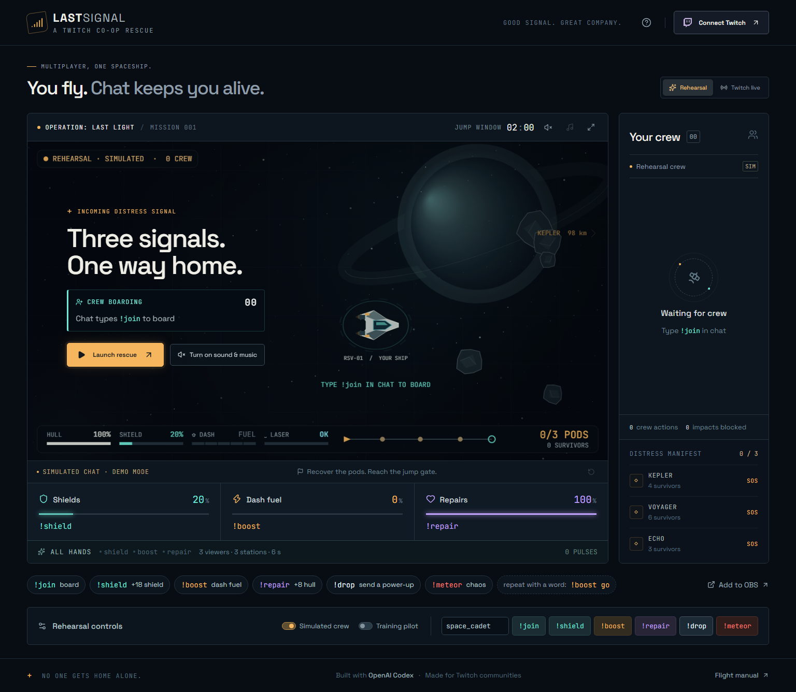

# LAST SIGNAL

**You fly. Chat keeps you alive.**

A cooperative space rescue built for Twitch. The streamer pilots a damaged ship through an asteroid field. Viewers type `!join` to board before launch, then become its named crew: they power shields, fuel the pilot's dash, repair the hull, send power-up crates the pilot has to catch (`!drop`), or throw named meteors at the pilot for fun (`!meteor`). The pilot flies, shoots, dashes and fires the gifts chat sends. Three people coordinating different stations create an **ALL HANDS** rescue pulse. Recover the escape pods before the jump window closes, then put the people who made it happen in the credits.

Built with OpenAI Codex for the Codex × TwitchCon Hackathon. No paid inference service, game engine, or database is required to run it.



## Run in two minutes

Requires **Node.js 24+** and npm. Windows, macOS, or Linux.

```sh
npm ci
npm run build
npm start
```

Open **http://localhost:3001**. No credentials are needed for rehearsal.

1. Click **Turn on sound & music** (browsers only allow audio after a click).
2. Leave **Simulated crew** on. Optionally board a few viewers with the manual **!join** button to see the lobby fill.
3. Click **Launch rescue**, then click the flight screen.
4. Fly with **WASD / arrow keys** and enter the amber rings to rescue pods. **Space** fires the laser, **Shift** dashes (burns boost fuel from chat), **E** fires the power-up a viewer sent, **P** or **Esc** pauses. Hold **D** at the front of the zone for the afterburner.
5. Turn on **Training pilot** for a reproducible, hands-free rehearsal, or pilot yourself.
6. Try the manual viewer controls below the flight screen. Every simulated action is visibly labeled.

The mission lasts up to 120 seconds. The training pilot with simulated crew completes the default seed in about 106 seconds, rescuing all 13 survivors (measured 2026-11-02 after the gameplay update). Collisions, shields, repairs, rescues, and the result are calculated by the game; the demonstration is not a scripted video or predetermined win.

## Twitch integration — no keys required

1. Click **Connect Twitch**.
2. Enter your channel name (for example, `your_channel`, without a URL).
3. Click **Join live chat**. The app confirms the actual Twitch channel room ID.
4. Viewers type `!join` to board while you are on the launch screen; the lobby lists them on stream. Commands sent before launch or during the countdown precharge the ship.
5. Launch a rescue. Viewers send `!shield`, `!boost`, or `!repair`. If a command cannot apply (hull already full, recharging, mission paused), the feed and the on-stream ticker say why.

This path uses a **read-only anonymous connection to Twitch IRC**. It requires no application registration, client ID, client secret, or 2FA setup for the game connection. Viewers send messages through their ordinary Twitch accounts. The server never sends chat messages. A successful connection to `anashk123` was tested against Twitch on 2026-11-02; the complete command path is recorded in [VALIDATION.md](docs/VALIDATION.md).

Anonymous IRC is a compatibility path discussed on the [Twitch developer forums](https://discuss.dev.twitch.com/t/possible-to-connect-to-twitch-irc-anonymously/5921). Twitch recommends EventSub for new integrations, and that option is also implemented below. The anonymous behavior is tested against the current service rather than promised as a future API guarantee.

### Optional OAuth / EventSub connection

The optional registered-app connection uses Twitch's **OAuth authorization code flow** and **EventSub WebSockets**, with the `channel.chat.message` subscription. The only permission requested is `user:read:chat`. Tokens stay in server memory and are discarded on restart or disconnect. There is no token in the browser, URL, mission report, or Git repository.

### Configure your application

1. Register an application at [Twitch Developer Console](https://dev.twitch.tv/console/apps). Choose a **Confidential** client.
2. Add this exact OAuth redirect URL:

   ```text
   http://localhost:3001/auth/twitch/callback
   ```

3. Copy `.env.example` to `.env`. Fill in the application's client ID and generated client secret:

   ```dotenv
   TWITCH_CLIENT_ID=your_application_client_id
   TWITCH_CLIENT_SECRET=your_application_client_secret
   APP_URL=http://localhost:3001
   PORT=3001
   HOST=127.0.0.1
   ```

4. Restart `npm start`. Open the console at `http://localhost:3001`, click **Connect Twitch**, expand **Optional: OAuth / EventSub connection**, and authorize your account.
5. The connection starts with your own channel. You can change the listening channel in the connection dialog before launching a mission. An offline channel with accessible chat is sufficient; a live video broadcast is not required.
6. Select **Twitch live**, launch, and ask a viewer to type `!shield`, `!boost`, or `!repair` in that channel. The connection dialog counts actual received messages. Check the named action in the crew feed and the corresponding resource change.

Do not paste a secret into chat or commit `.env`. The server binds to loopback by default; this is a local streamer tool rather than a hosted multi-user service. Use the same computer for OBS and the pilot console. `.env` is loaded at server startup, so changes need a restart.

### Commands and fairness

| Chat command | Effect | Role |
|---|---|---|
| `!join` | Board the crew before launch; assigned to the least-staffed station | Fill the lobby; no charge spent |
| `!shield` | +18 shield, capped at 100 | Absorb asteroid damage before hull damage |
| `!boost` | +22 dash fuel, capped at 100 | The pilot burns 20 fuel per dash (Shift) |
| `!repair` | Restore 8 hull, capped at 100 | Prevent a hull failure |
| `!drop` | Launches a crate with your name: NOVA BOMB, BUBBLE SHIELD or OVERDRIVE GUNS | The pilot catches it and fires it with E; you earn 25 points |
| `!meteor` | Throws a named meteor at the pilot after a red warning line | Chaos: the pilot dodges or shoots it down |

Any words after the command are ignored, so `!boost go` works. Twitch can block a viewer from sending the exact same message twice in a row, so the on-stream footer tells viewers to add a word when repeating. Commands work in the lobby and during the countdown (precharging the ship).

**Pilot abilities.** The laser destroys asteroids (big ones crack first and need two hits) and shoots down meteors, but overheats if held too long. A dash costs 20 fuel, nearly triples speed for about a second and smashes small rocks in the way; dashes need 3.5 seconds between them. Crates hold one of three power-ups: NOVA BOMB clears the screen, BUBBLE SHIELD rams anything for five seconds, OVERDRIVE GUNS fires a rapid triple laser for six seconds.

**Dynamic hazards.** Five debris walls with a single gap cross the route (find the gap or blast through), comets fire at the ship in the storm sector, and viewer meteors arrive with a warning line that shows their exact path.

**Crew-scaled debris.** Asteroid damage scales with crew size: 50% with no crew, rising to full strength at five crew. Cruise speed alone reaches the jump gate in about 115 seconds. In simulation with a bot pilot (12 seeded runs per setting, measured 2026-11-02): a solo pilot who shoots accurately finished every run but with about a third of the hull left; a solo pilot who never fires finished none; with two viewers helping, even a pilot who never fires finished every run. Skill and chat both matter.

**Afterburner.** The ship eases to a stop at the front of the flight zone instead of hitting the screen edge. Holding forward there fires an afterburner for extra speed, at the cost of less reaction time.

Each viewer has a 1.8-second cooldown (displayed as approximately 2 seconds). The uplink accepts up to 15 commands per second and 500 unique crew members per mission. Full systems reject extra commands. Only accepted, effective contributions earn points. Ordinary chat is ignored by the game and is not displayed or stored.

**ALL HANDS:** three distinct viewers activate the three different stations within six seconds. A six-second tractor pulse increases rescue range from 100 to 195 world units. Each contributor earns 40 bonus points. One person cannot fill all three stations alone.

### Integration verification

See [VALIDATION.md](docs/VALIDATION.md) for the exact testing evidence and live-validation status. A successful transport handshake is separate from an authorized subscription and a real channel message. Rehearsal never claims to be real Twitch activity, and live missions reject simulated input.

Official resources used:

- [Authorization code flow](https://dev.twitch.tv/docs/authentication/getting-tokens-oauth/#authorization-code-grant-flow)
- [Token validation](https://dev.twitch.tv/docs/authentication/validate-tokens/)
- [EventSub WebSocket lifecycle](https://dev.twitch.tv/docs/eventsub/handling-websocket-events/)
- [Chat message subscription](https://dev.twitch.tv/docs/eventsub/eventsub-subscription-types/#channelchatmessage)
- [Creating subscriptions](https://dev.twitch.tv/docs/eventsub/manage-subscriptions/)

## Sound

Click **Turn on sound & music** on the launch screen or the speaker icon in the mission toolbar. The music is a synthwave loop generated live with Web Audio (no audio files, so no licensing questions): calm in the lobby, driving in flight, tenser in the debris storm, with a fanfare on victory and a sting on defeat. The music-note icon mutes only the music. The choice is remembered for the browser session. The OBS view stays silent so the stream does not capture the audio twice; capture the pilot console's audio instead.

## Security model

The server binds to `127.0.0.1` by default. Only a console on the same computer receives the control key; any other machine (if you widen `HOST`) gets a view-only page. Requests must use an allowlisted Host name, which blocks DNS-rebinding pages; add extra names with `ALLOWED_HOSTS=name:port,...`. State-changing requests also require an allowlisted Origin.

## OBS broadcast view

Add a **Browser Source** with URL `http://localhost:3001/overlay`, width **1920**, height **1080**, and **60 fps**. Leave “Shutdown source when not visible” unchecked. The **Add to OBS** button provides the URL and settings.

Keep the pilot console open. The broadcast is a spectator of the same authoritative server simulation and cannot send control inputs. Both screens show the same ship, viewer names, rescue state, and credits. The rehearsal label remains visible in the broadcast. Enable sound in the pilot console if wanted; avoid capturing duplicate audio sources.

## Development and tests

```sh
npm run dev         # game server :3001 and Vite :5173
npm run check       # strict TypeScript validation
npm test            # deterministic engine and EventSub fixture tests
npx playwright install chromium
npm run test:e2e    # builds and launches an isolated server :3002
```

Development UI: `http://localhost:5173`. OAuth keeps the registered `http://localhost:3001/auth/twitch/callback`; after sign-in Twitch returns you to the page that started it (the Vite page in development, port 3001 in production). Only allowlisted origins are accepted as return targets. The Vite proxy forwards `/api`, `/auth`, and `/ws`. The production-style quickstart above is recommended for the demo. Set `E2E_PORT` to run the browser suite on another port.

Browser tests cover actual keyboard movement, viewer input, pause/reset, source separation, setup dialogs, mobile overflow, unauthorized mutations, an entire real-time rescue, synchronized OBS results, and the downloadable mission report. The test server has Twitch credentials explicitly disabled. EventSub fixtures test authentication checks, subscription payloads, message deduplication, channel filtering, reconnection, and unsafe URL rejection. They do not claim to prove a live channel integration.

## Architecture

```text
Twitch chat → IRC / EventSub → Twitch adapter → authoritative game engine
                                             ↑         ↓
                                     pilot inputs   snapshots
                                             ↑         ↓
                                      React console / OBS canvas
```

- `server/game.ts`: deterministic physics, mission, crew actions, fairness, coordinated pulse.
- `server/twitch.ts`: OAuth exchange, validation/refresh, subscription, reconnect, deduplication.
- `server/irc.ts`: credential-free read-only chat, IRC frame parsing, PING/PONG, channel confirmation, reconnect, and deduplication.
- `server/index.ts`: local HTTP/WebSocket server, OAuth state, spectator permissions, reports.
- `shared/types.ts`: typed protocol, state, and exact command parser.
- `src/Space.tsx`: procedural Canvas spacecraft, planet, asteroids, named drones, particles, HUD.
- `src/App.tsx`: pilot workflow, lobby, crew feed, setup, rehearsal controls, results, broadcast.
- `src/audio.ts`: synthesized soundtrack and sound effects (Web Audio, no audio files).

Simulation and snapshots run at 30 Hz. The browser extrapolates the ship from the newest snapshot and the pilot's held keys, so steering responds immediately while collisions stay server-authoritative. All game rules run on the server. The default route uses a fixed seed so demos are repeatable. Session state is intentionally in memory; restarting the server resets the mission and Twitch connection. Only one active pilot controls the ship; another console can take over when the first stops sending input. There is no user-account service, database, public-hosting authentication, or mobile touch-flight controller.

## Submission

- [Project description](docs/PROJECT_DESCRIPTION.md)
- Demo video: **YouTube link to be added after upload.**
- Prepared demo MP4: `artifacts/demo/last-signal-demo.mp4` (2:32, full working rehearsal recorded before the polish pass; captions and synthesized draft narration).
- Downloadable demo and captions: [GitHub release](https://github.com/Anas-HK/last-signal/releases/tag/v0.1.0).
- [Under-three-minute video script and recording instructions](docs/DEMO_SCRIPT.md)
- [Submission checklist](docs/SUBMISSION.md)
- [Codex session and development record](docs/CODEX_SESSION.md)
- [Sprint decisions](docs/SPRINT.md)

**Codex session ID:** `01a19ccf-e07f-7e72-9a32-fcae9d50c948`. It was captured from this active session's environment. Confirm with `/status` in Codex before submitting.

## Credits

The original product, implementation, tests, and iterative debugging were built in this Codex session (see [CODEX_SESSION.md](docs/CODEX_SESSION.md)). Later polish commits are listed separately in the Git history. A [Superdesign draft](https://superdesign.dev/teams/e0cb2fff-718e-4bb7-8150-f93a155ef1ff/projects/597d54cc-621a-4534-98ae-35d2ab50face) supported the visual direction. The game artwork is procedural Canvas code. Fonts are bundled locally under their SIL Open Font Licenses in `public/fonts`. UI icons: Lucide (ISC). Application code: MIT.
